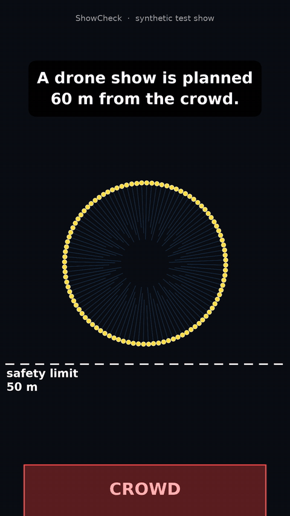

# ShowCheck

[](demo/showcheck_demo.mp4)

*20-second demo (synthetic test show)*

An independent pre-launch check of a drone-show file against the venue plan.

ShowCheck reads the show file (Skybrush `.skyc`, or `.vviz` at visualization grade) and a small venue file you write
(origin, heading, pads, crowd areas, fence, limits). It then gives a PASS / WARN / FAIL verdict per check, an HTML
report with a top-view picture, and a fingerprint manifest.

## The six checks

| Check | What it looks at |
|---|---|
| **C1 Placement** | The show's origin and heading match the venue plan, and every drone's home is on its assigned pad. |
| **C2 Crowd distance** | No drone comes closer to a crowd area than that area's buffer. |
| **C3 Geofence** | The file's fence matches the venue fence, every drone stays inside it with the buffer margin, and maximum altitude is within the limit. |
| **C4 Speed and acceleration** | Max speed and acceleration are within the venue limits. For `.skyc` files they are computed exactly from the curves; the 10 Hz sampled values are shown alongside. |
| **C5 Spacing** | The closest approach between any two drones is at least the minimum spacing. |
| **C6 Fingerprint** | One SHA-256 per drone (trajectory and lights) plus the placement, to compare with what each drone actually received. |

## Quick start

Needs Python 3.10 or later.

```
git clone https://github.com/forgottenl5/showcheck
cd showcheck
pip install -r requirements.txt

python -m showcheck.cli examples/synthetic_clean.skyc   --venue examples/synthetic_venue.json --out reports
python -m showcheck.cli examples/synthetic_shift18.skyc --venue examples/synthetic_venue.json --out reports
```

Open `reports/synthetic_shift18.html` in a browser. It shows the verdict table with the numbers behind each
verdict, the top view, and the manifest. The exit code is 1 if any check FAILs.

Other commands:

```
python -m showcheck.cli compare A.manifest.json B.manifest.json      # which drones differ or are missing
python -m showcheck.cli anonymize my_show.skyc shareable.skyc --venue my_venue.json shareable_venue.json
python -m pytest tests                                                # run the test suite
```

The venue file format is described in `venue_format.md`, with an example in `venue_example.json`. What is known
about the file formats, and how sure we are of each point, is in `FORMAT_NOTES.md`.

## What is verified, and what is not

**Verified:** the `.skyc` axes, heading and timing conventions were confirmed against real Skybrush Studio exports.
ShowCheck's positions match Blender's own positions to within about 10 cm.

**Not verified:**
- The geofence layout inside `.skyc` files. Skybrush Studio does not write one, so it comes from code reading only.
- Any real show or real fleet. The examples are synthetic.
- `.vviz` is visualization-grade only: no heading, no fence, and positions between samples are interpolated
  linearly.

**Not a safety certification. Use alongside your normal procedures.**

## Try it on your show

Run it locally on your own show; nothing is uploaded. Then tell us what it caught, what it missed, or what it
flagged wrongly, via [GitHub Issues](https://github.com/forgottenl5/showcheck/issues) or forgotteni5.lab@gmail.com.

Before sharing any file, anonymize it with `python -m showcheck.cli anonymize`. This moves the origin to a fake
location (lat 0.0100, lon 0.0100) and strips names and metadata, while keeping the geometry. With `--venue`, the
venue moves too and keeps its offset to the show, so a placement error is still visible.

## Licence

AGPL-3.0 (see `LICENSE`). Commercial licences are available on request; see `COMMERCIAL.md`.
ShowCheck is independent of Skybrush and contains no Skybrush code.
